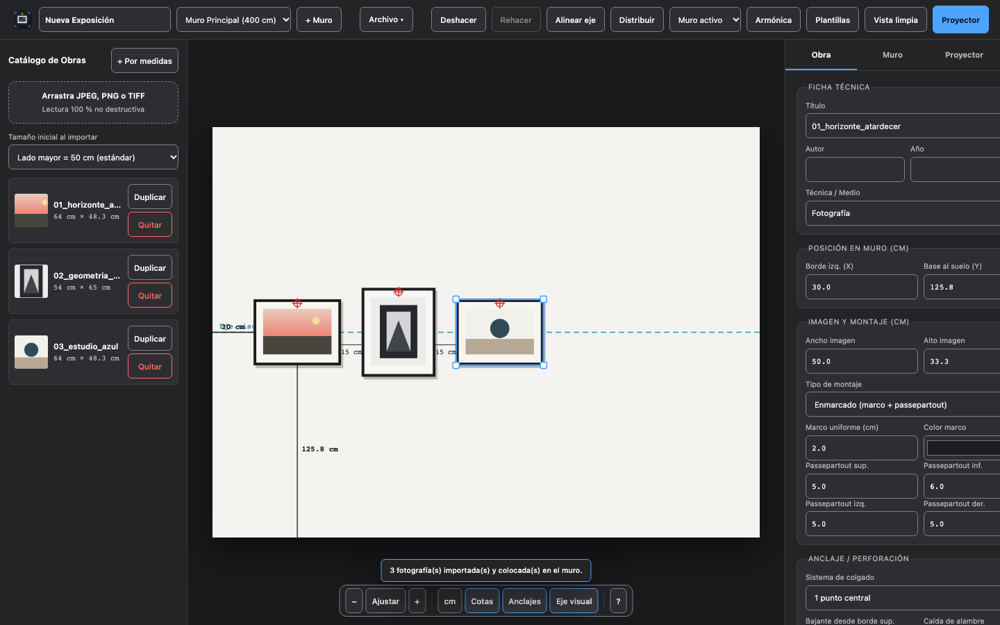

# LayoutExpo

Estudio nativo 2D de curaduría, montaje métrico y asistencia en sala mediante proyector multimedia para exposiciones fotográficas.



- **Ejecución nativa multiplataforma:** macOS Apple Silicon (`arm64`), macOS Intel (`x86_64`) y Windows (`x64`) usando WebView nativo del sistema (`Cocoa / WKWebView` en macOS y `Edge WebView2` en Windows 11).
- **100 % Local y No Destructivo:** Lee `JPEG`, `PNG` y `TIFF` en modo solo lectura preservando orientación EXIF y convirtiendo perfiles ICC a `sRGB` en caché local de proxies.
- **Precisión Métrica Exacta (`dmm`):** Toda medida interna opera en décimas de milímetro (`1 mm = 10 dmm`) en Sistema Métrico Internacional (`cm` / `mm`).
- **Asistencia con Proyector en Sala:** Ventana secundaria a pantalla completa en `#000000` con homografía 2D de 4 puntos (*keystone*), proyección por tramos en muros largos y cruces exactas de perforación/clavos.

## Ejecución en desarrollo

Requiere Python `>=3.11`. Crea el entorno virtual e instala las dependencias de aplicación y desarrollo (incluyendo Chromium para pruebas E2E/WCAG):

```bash
python3 -m venv .venv
.venv/bin/pip install -e ".[app,dev]"
.venv/bin/playwright install chromium
```

Para iniciar la aplicación nativa:

```bash
chmod +x run.sh
./run.sh
```

Para abrirlo en un navegador local durante pruebas de interfaz:

```bash
.venv/bin/python main.py --browser
```

## Flujo de montaje con Proyector Multimedia

1. **Diseña el muro en Estudio:** Configura dimensiones del muro (`cm`), altura de zócalo y eje visual (por defecto `150 cm`). Importa tus fotografías (`JPEG`/`PNG`/`TIFF`) o crea piezas por medidas (`+ Por medidas`). Configura marco, passepartout (simétrico o asimétrico), montaje directo (`dibond`/`lona`) y tipo de anclaje (`1 punto central` o `2 puntos laterales`, más caída de alambre).
2. **Conecta el proyector:** En el inspector **Proyector**, selecciona la pantalla externa del proyector y pulsa **Abrir en proyector**.
3. **Calibración en 4 puntos (*Keystone*):** Pulsa `G` en la ventana del proyector para mostrar el polígono de calibración, marca 4 puntos conocidos en la pared real con cinta métrica y ajusta las 4 esquinas `(U, V)` en el inspector hasta hacerlos coincidir físicamente.
4. **Muros largos por tramos:** Si la pared supera el ancho cubierto por el proyector, define `Inicio X (cm)` y `Ancho tiro (0=todo)` para avanzar por secciones sin perder precisión.
5. **Exportación de respaldo PDF:** Pulsa **Exportar PDF** para generar el plano técnico acotado (distancias al suelo, bordes y puntos de perforación), la lista de obra y las cartelas de sala.

## Atajos de teclado y accesibilidad (WCAG 2.2 AA)

- `Tab` / `Shift+Tab`: Navegar entre obras colocadas en el muro y controles.
- `Flechas`: Mover obra seleccionada `1 mm` (`Shift + Flechas`: `1 cm`).
- `Alt + Flechas`: Redimensionar obra seleccionada (`1 cm`).
- `Delete` / `Backspace`: Retirar obra seleccionada del muro.
- `Cmd/Ctrl + Z`: Deshacer (`Cmd/Ctrl + Shift + Z` / `Ctrl + Y`: Rehacer).
- `Cmd/Ctrl + S`: Guardar proyecto `.layoutexpo`.
- `V`: Activar/salir de **Vista limpia** (oculta paneles para evaluar la curaduría).
- `Esc`: Cerrar paneles abiertos en Estudio.
- En Proyector: `G` (patrón calibración), `A` (cruces de anclaje), `E` (eje visual), `F` (pantalla completa), `H` (ocultar/mostrar barra), `Esc` (mostrar barra).

## Empaquetado nativo y verificación

```bash
# Calidad y pruebas (lint, mypy estricto, unit, integración y WCAG 2.2 AA E2E)
.venv/bin/ruff check .
.venv/bin/mypy
.venv/bin/pytest -v

# Empaquetado nativo (.app en macOS / .exe en Windows)
.venv/bin/pip install -e ".[app,build]"
.venv/bin/pyinstaller --noconfirm layoutexpo.spec

# Firma ad-hoc limpia en macOS (elimina atributos extendidos APFS)
xattr -cr dist/LayoutExpo.app
codesign --force --deep --sign - dist/LayoutExpo.app
codesign --verify --deep --strict dist/LayoutExpo.app
```

## Documentación

- [Manual de Usuario](docs/MANUAL_USUARIO.md)
- [Arquitectura del Sistema](docs/ARCHITECTURE.md)
- [Sistema de Diseño](docs/DESIGN_SYSTEM.md)
