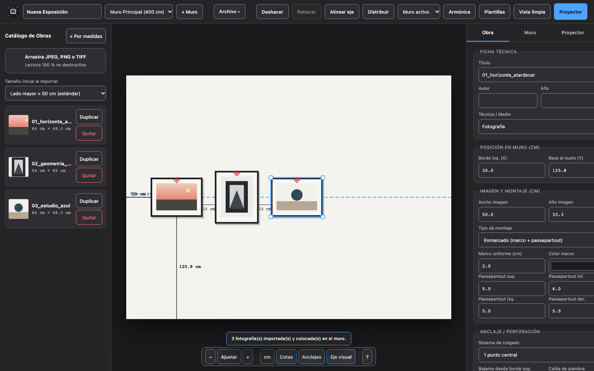
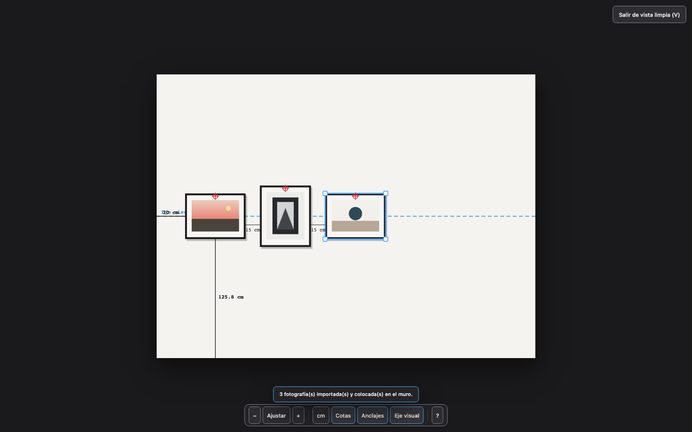
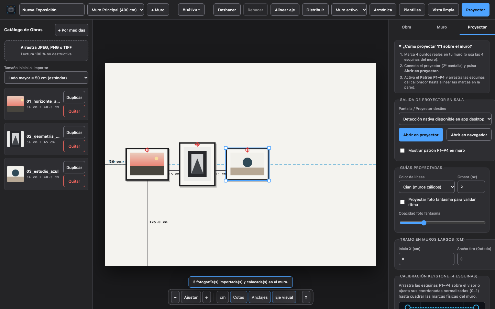
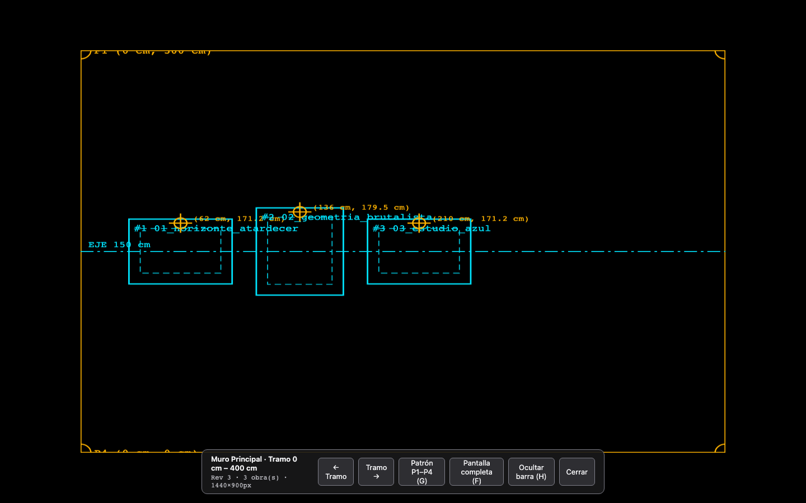

# Manual de Usuario — LayoutExpo (v0.2.4)

LayoutExpo es una aplicación nativa de escritorio para **curaduría 2D, montaje métrico exacto y asistencia en sala mediante proyector multimedia** para exposiciones fotográficas.

---

## 1. Interfaz del Estudio

Al abrir LayoutExpo se muestra el espacio de trabajo dividido en cuatro zonas principales:

1. **Barra superior:** Nombre de la exposición, selector de muro (`+ Muro`), menú **Archivo** (Nuevo, Abrir, Guardar `.layoutexpo`, Exportar PDF), **Deshacer / Rehacer**, herramientas de alineación y distribución (**Alinear eje**, **Distribuir**, **Armónica**), **Plantillas**, **Vista limpia** y acceso al **Proyector**.
2. **Catálogo de Obras (panel izquierdo):** Permite arrastrar o importar fotografías (`JPEG`, `PNG`, `TIFF` en modo solo lectura) o crear piezas sin archivo mediante **`+ Por medidas`**.
3. **Lienzo del Muro (centro):** Vista a escala en centímetros/milímetros con eje visual horizontal (por defecto `150 cm`), cotas automáticas, puntos de anclaje y barra inferior de zoom y visibilidad (**Cotas**, **Anclajes**, **Eje visual**).
4. **Inspector (panel derecho):** Organizado en tres pestañas: **Obra**, **Muro** y **Proyector**.

---

## 2. Diseño del muro y montaje de obras

### 2.1 Configuración del muro
En la pestaña **Muro** del inspector define:
- Ancho y alto total del muro (`cm`).
- Altura de zócalo (`cm`) y altura del **eje visual** (por defecto `150 cm`).
- Color de fondo del muro para simular la sala real.

### 2.2 Importación y ficha técnica de obras
- Arrastra imágenes `JPEG`, `PNG` o `TIFF` al área de carga (o usa el selector de archivos). LayoutExpo respeta la orientación EXIF y convierte perfiles ICC a `sRGB` en una caché local de proxies sin modificar tus archivos originales.
- Selecciona el tamaño inicial al importar (por ejemplo, `Lado mayor = 50 cm (estándar)`) o usa **`+ Por medidas`** para piezas físicas sin imagen digital.
- En la pestaña **Obra** puedes editar:
  - **Ficha técnica:** Título, Autor, Año y Técnica / Medio.
  - **Posición en muro (`cm`):** Borde izquierdo (`X`) y base al suelo (`Y`).
  - **Imagen y montaje (`cm`):** Dimensiones de imagen, tipo de montaje (enmarcado con marco y passepartout simétrico o asimétrico, o montaje directo en *dibond*/lona).
  - **Anclaje / Perforación:** `1 punto central` o `2 puntos laterales`, bajante desde el borde superior y caída de alambre.

### 2.3 Evaluación visual en Vista limpia
Pulsa **`v`** (o el botón **Vista limpia**) para ocultar los paneles laterales y evaluar la composición curatorial sin distracciones.

---

## 3. Montaje en sala con Proyector Multimedia

En la pestaña **Proyector** del inspector se configuran la salida secundaria, las guías visuales y la calibración geométrica sobre la pared real.

### Paso a paso en sala
1. **Conecta el proyector:** En **Salida de proyector en sala**, selecciona la pantalla externa del proyector y pulsa **Abrir en proyector** (se abrirá una ventana secundaria a pantalla completa con fondo `#000000`).
2. **Activa el patrón de calibración (`G`):** Pulsa `G` en la ventana del proyector (o activa **Mostrar patrón P1–P4 en muro**) para visualizar el polígono de calibración y las esquinas `P1–P4`.
3. **Calibración *Keystone* en 4 puntos:** Marca 4 puntos conocidos en la pared real con cinta métrica y ajusta las 4 esquinas `(U, V)` en **Calibración Keystone (4 esquinas)** hasta que el polígono proyectado coincida exactamente con las marcas físicas.
4. **Muros largos por tramos:** Si la pared supera el ancho cubierto por el proyector, define **`Inicio X (cm)`** y **`Ancho tiro (0=todo)`** para proyectar por secciones consecutivas (`← Tramo` / `Tramo →`) sin perder precisión métrica.
5. **Marcado de perforaciones:** Usa las cruces de anclaje proyectadas (con sus coordenadas exactas) para marcar en la pared los puntos de clavos o tarugos.

---

## 4. Exportación de respaldo PDF

Desde el menú **Archivo → Exportar PDF** se genera un documento técnico de respaldo que incluye:
- Plano acotado de cada muro (distancias al suelo, a los bordes laterales y coordenadas exactas de perforación).
- Lista completa de obra.
- Cartelas de sala listas para imprimir.

---

## 5. Atajos de teclado

### En Estudio
| Atajo | Acción |
| :--- | :--- |
| `Tab` / `Shift + Tab` | Navegar entre obras colocadas en el muro y controles |
| `Flechas` | Mover obra seleccionada `1 mm` |
| `Shift + Flechas` | Mover obra seleccionada `1 cm` |
| `Alt + Flechas` | Redimensionar obra seleccionada (`1 cm`) |
| `Delete` / `Backspace` | Retirar obra seleccionada del muro |
| `Cmd/Ctrl + Z` | Deshacer |
| `Cmd/Ctrl + Shift + Z` / `Ctrl + Y` | Rehacer |
| `Cmd/Ctrl + S` | Guardar proyecto `.layoutexpo` |
| `v` | Activar/salir de **Vista limpia** |
| `Esc` | Cerrar paneles abiertos en Estudio |

### En Proyector
| Atajo | Acción |
| :--- | :--- |
| `G` | Mostrar/ocultar patrón de calibración `P1–P4` |
| `A` | Mostrar/ocultar cruces de anclaje |
| `E` | Mostrar/ocultar eje visual |
| `F` | Alternar pantalla completa |
| `H` | Ocultar/mostrar barra de controles (HUD) |
| `Esc` | Mostrar barra de controles si está oculta |
